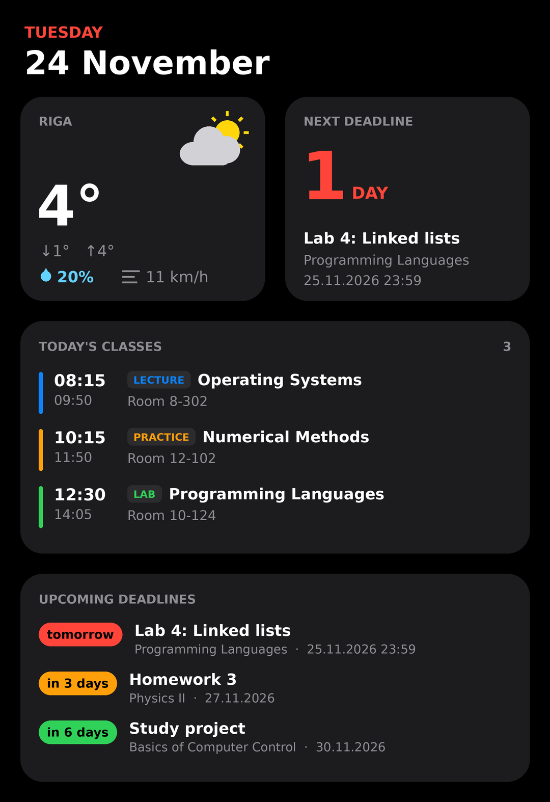
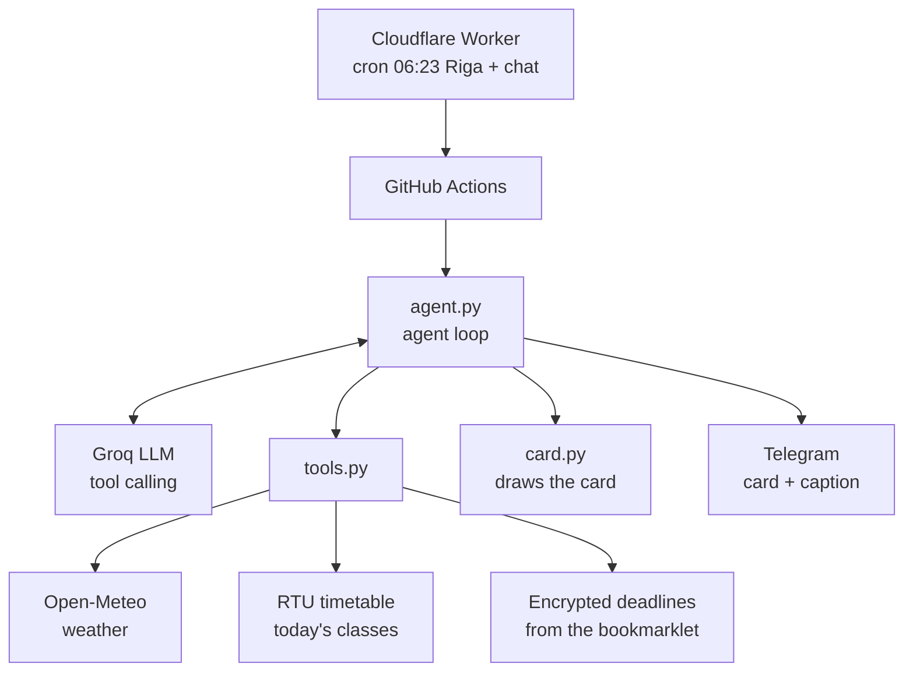

# morning-agent ☀️

A personal AI agent that plans my mornings. Every day before my first class it sends me a
Telegram card with the Riga weather, today's classes at Riga Technical University (RTU)
and a countdown of my upcoming assignment deadlines. It runs entirely on free tiers.

<p align="center"></p>
<p align="center"><sub>Example card (sample data)</sub></p>

## Highlights

- **Agent with tool calling:** the LLM decides which tools to call (date, weather, classes, deadlines), my code runs them and sends the results back until the model is done.
- **$0 hosting:** a Cloudflare Worker (free plan) triggers it on time every morning and doubles as a Telegram chatbot. GitHub Actions does the work, and the model runs on Groq's free tier (`openai/gpt-oss-120b`).
- **Tokens only where they matter:** the AI writes a 3-line caption. The card is drawn with Pillow in plain Python, so it uses no tokens.
- **Working around a locked portal:** the university's Moodle has no calendar export and needs 2FA, so the bot can't log in. A bookmarklet uses my logged-in browser session to read the deadlines and saves them **encrypted** (PBKDF2 + AES-GCM) to a repository variable.
- **Private by design:** keys live in GitHub Secrets, deadline data is encrypted, and the message content is never printed to the public Actions log.

## How it works



| File | What it does |
|---|---|
| `agent.py` | The agent loop: ask the model → run the tools it asks for → send results back → send the card to Telegram |
| `llm.py` | The only place that talks to the model (Groq). Switching providers only changes this file |
| `tools.py` | The agent's tools (plain Python functions) and their descriptions for the model |
| `card.py` | Draws the dark, iPhone-widget style card with Pillow |
| `bookmarklet/` | One-click bookmark that syncs e-studijas (Moodle) deadlines, encrypted ([setup](bookmarklet/README.md)) |
| `worker/worker.js` | Cloudflare Worker (free): starts the morning run on time every day and answers my Telegram messages with Groq |
| `.github/workflows/morning.yml` | The job that draws and sends the card, started by the Worker or by hand |

## Setup

GitHub → **Settings → Secrets and variables → Actions → Secrets**:

| Secret | Where to get it | Required |
|---|---|---|
| `GROQ_API_KEY` | console.groq.com → API Keys | ✅ |
| `TELEGRAM_BOT_TOKEN` | Telegram → @BotFather → `/newbot` | ✅ |
| `TELEGRAM_CHAT_ID` | Message your bot, then open `https://api.telegram.org/bot<TOKEN>/getUpdates` | ✅ |
| `RTU_SEMESTER_PROGRAM_ID` | nodarbibas.rtu.lv → DevTools → Network → `getSemesterProgEventList` → `semesterProgramId` | For classes |
| `DEADLINES_KEY` | A password you make up; you type the same one into the bookmarklet once | For deadlines |
| `ORTUS_ICAL_URL` | An iCal link (fallback if your Moodle allows calendar export) | Optional |

Optional variable: `MESSAGE_LANGUAGE` (e.g. `Turkish`, default `English`).

Then: **Actions → Morning agent → Run workflow** to test.

Run locally:

```bash
pip install -r requirements.txt
export GROQ_API_KEY=...   # Windows PowerShell: $env:GROQ_API_KEY="..."
python agent.py           # also saves the card as morning.png
```

## Stack

Python · Groq LLM API (tool calling) · GitHub Actions · Telegram Bot API · Pillow · Web Crypto / `cryptography`
